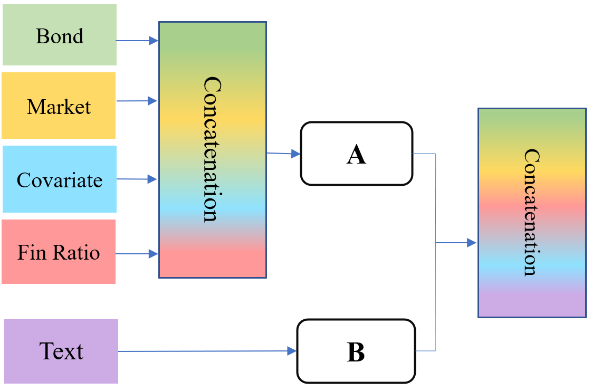
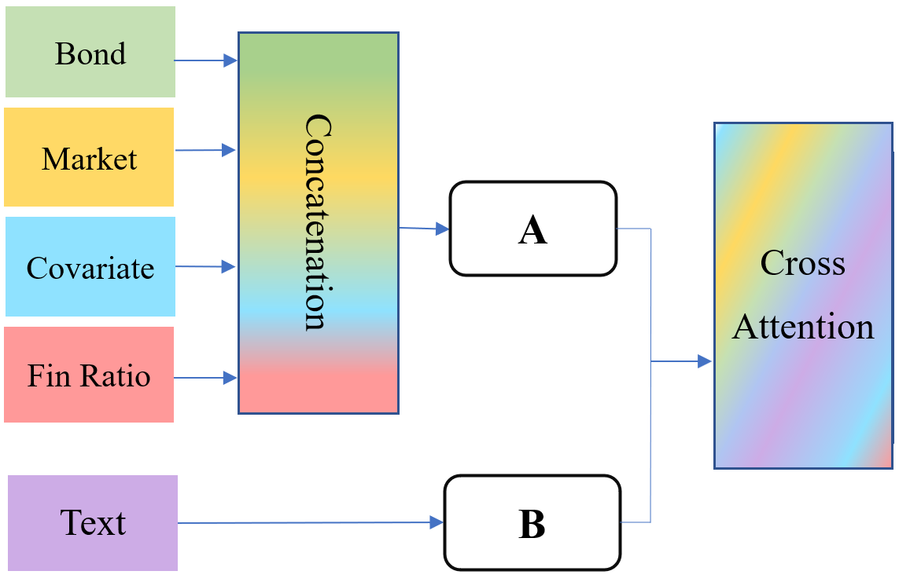
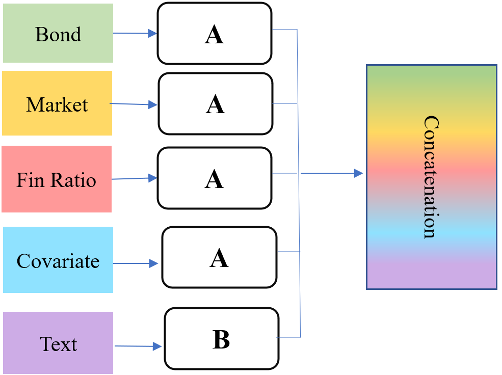
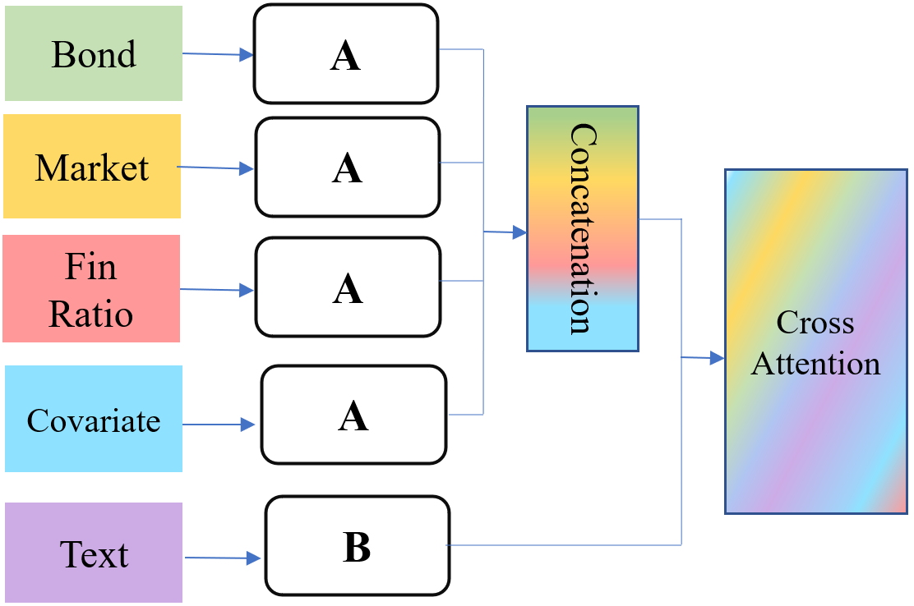

# MultimodalFusionRatings

Code for the paper:

> Mahsa Tavakoli, Rohitash Chandra, Fengrui Tian, Cristián Bravo (2025). Multi-modal deep learning for credit rating prediction using text and numerical data streams. *Applied Soft Computing*, 171, 112771. <https://doi.org/10.1016/j.asoc.2025.112771>

Preprint: [arXiv:2304.10740](https://arxiv.org/abs/2304.10740).

The paper studies multimodal and information fusion strategies for credit rating modelling. Its models
predict companies' credit rating classes from four structured channels (market, bond, financial ratio
and covariate data) and one unstructured channel (earnings call transcripts). It compares fusion levels
(early, or signal, fusion and intermediate, or feature, fusion) and fusion techniques (concatenation and
cross-attention) in 16 models, built from CNN, LSTM, GRU and BERT submodels. In the paper, the best
model is CNN-based and combines two fusion strategies, and more complex architectures do not
necessarily perform best. This repository holds the four notebooks that build and train the 16 models,
the data documentation, and a synthetic data sample.

## Requirements

The notebooks' metadata records Python 3.9.7. The code uses TensorFlow and Keras, TensorFlow Hub for
BERT, NLTK and clean-text for text preprocessing, and scikit-learn and mlxtend for evaluation.

```bash
pip install -r requirements.txt
```

The versions used for the paper were not recorded. The notebooks also need Jupyter, which
`requirements.txt` does not list. Each notebook downloads the NLTK corpora `stopwords`, `punkt`,
`wordnet` and `words` when it runs.

The paper reports that the experiments used NVIDIA T4 GPUs with 16 GB of memory, and it reports the
elapsed time of each model in its Table 3. The notebooks enable memory growth on every GPU that
TensorFlow finds and create a `tf.distribute.MirroredStrategy`.

The BERT-based models load a TensorFlow Hub module from the relative path
`EXT/DDD/ce53fe6769d2ac3a260e92555120c54e1aecbea6`, which is not in this repository. In
`code/Group1.ipynb` and `code/Group2.ipynb`, a commented-out line just above names the TensorFlow Hub
handle `https://tfhub.dev/tensorflow/bert_en_uncased_L-12_H-768_A-12/1`.

## Data

The structured data come from Wharton Research Data Services (WRDS): CRSP for market data, Compustat
for financial ratios and ratings, and Mergent and TRACE for bond data. The text data are earnings call
transcripts from Seeking Alpha. The WRDS data are proprietary, so the raw data cannot be shared.

The folder `Data/` holds the data documentation and a synthetic sample:

- `Data/readme.md`: data access, the synthetic sample, and where the code expects its input file.
- `Data/Data Source & Collection.md`: the data sources and how the data were collected.
- `Data/Data characteristics and features.xlsx`: the source and description of each variable.
- `Data/Artificial_Data.xlsx`: a synthetic sample of 100 rows, made to reflect the structure of the original data.

Each notebook reads its input with `pd.read_csv("data.csv")`, a path relative to the notebook's working
directory. The synthetic sample is an Excel file with different column names, so it cannot be read by
the notebooks as they are. `Data/readme.md` lists the columns that the notebooks expect.

## Training

Each notebook in `code/` is one code cell that builds and trains one group of four models: a CNN-,
an LSTM-, a GRU- and a BERT-based model, one after another. Open a notebook with Jupyter and run it:

```bash
jupyter notebook code/Group1.ipynb
jupyter notebook code/Group2.ipynb
jupyter notebook code/Group3.ipynb
jupyter notebook code/Group4.ipynb
```

The notebooks split the data at random into 80% for training and 20% for testing (`random_state=0`)
and pass the test split to Keras as validation data. They do not save the trained models.

There are four groups of models. The notebook numbers follow the order below, which differs from the
group numbers in the paper; the last column gives the paper's group.

1. `code/Group1.ipynb`: signal fusion is used for the structured dataset. All numerical datasets are
   concatenated at the beginning and enter network A. The text is trained with network B. Then feature
   fusion combines the penultimate layers of the two modalities through concatenation.
2. `code/Group2.ipynb`: as in Group 1, all numerical datasets are fused at the beginning (signal
   fusion), and the concatenated numerical channel is sent to network A. The text channel is sent to
   network B, and their output layers are fused with cross-attention.
3. `code/Group3.ipynb`: each numerical dataset passes separately through network A, and the text
   dataset enters network B. Their penultimate layers are then concatenated. Only the feature level of
   fusion is used.
4. `code/Group4.ipynb`: the four numerical channels are trained separately by model A, and the text
   channel by model B. The penultimate layers of the numerical modalities are concatenated, and the
   text layer and the concatenated layer are fused with cross-attention.

| Notebook | Numerical channels | Fusion with the text channel | Group in the paper | Diagram |
|---|---|---|---|---|
| `code/Group1.ipynb` | fused into one input | concatenation | Group 3, Hybrid Concatenation | `Picture1.png` |
| `code/Group2.ipynb` | fused into one input | cross-attention | Group 4, Hybrid Concatenation-Attention | `Picture2.png` |
| `code/Group3.ipynb` | four inputs, one network each | concatenation | Group 1, Simple Concatenation | `Picture3.png` |
| `code/Group4.ipynb` | four inputs, one network each | cross-attention | Group 2, Simple Concatenation-Attention | `Picture4.png` |






`Models' Architecture/Models' Architecture.md` describes the groups in the paper's numbering and links
one architecture diagram per model (`11.pdf` to `44.pdf`): the first digit is the paper's group, and
the second is the base model (1 CNN, 2 LSTM, 3 GRU, 4 BERT).

## Evaluation

Each notebook evaluates each of its four models on the 20% test split right after training. It prints
the weighted one-vs-rest AUC and the macro-averaged F1 score, accuracy, precision and recall, each with
a bootstrap interval from 10,000 resamples (the 5% and 95% quantiles of the bootstrap differences).
Some sections also plot a confusion matrix with mlxtend. `code/Group3.ipynb` saves one figure with
`plt.savefig('matrix1')`. No other results are written to files.

## Pretrained models

Not released.

## Results

| Table or figure in the paper | Command | Expected result |
|---|---|---|
| Table 3 (16 models, 30 runs each) | Not documented. Each notebook trains its four models once. | See the paper |
| Table 4 (out-of-time and out-of-universe tests) | Not documented | See the paper |
| Tables 5 and 6 (text and numerical channels alone) | Not documented | See the paper |
| Table 7 (before and after COVID-19) | Not documented | See the paper |
| Table 8 and Figure 12 (rating agencies and horizons) | Not documented | See the paper |
| Figure 11 (confusion matrix) | Not documented | See the paper |
| Figures 1, 2 and 8 to 10 (data description) | Not documented | See the paper |

## Citation

```bibtex
@article{tavakoli2025multimodal,
  title   = {Multi-modal deep learning for credit rating prediction using text and numerical data streams},
  author  = {Tavakoli, Mahsa and Chandra, Rohitash and Tian, Fengrui and Bravo, Cristi{\'a}n},
  year    = {2025},
  journal = {Applied Soft Computing},
  volume  = {171},
  pages   = {112771},
  doi     = {10.1016/j.asoc.2025.112771},
}
```

`CITATION.cff` holds the same reference for GitHub's "Cite this repository" button.

## Licence

GPL-3.0. See `LICENSE`.

## Acknowledgements

From the paper: M. Tavakoli, F. Tian and C. Bravo acknowledge the support of the NSERC Discovery Grant
program [RGPIN-2020-07114]. The research was partly funded by the Canada Research Chairs program
[CRC-2018-00082] and by Compute Ontario, Calcul Québec and the Digital Research Alliance of Canada.
